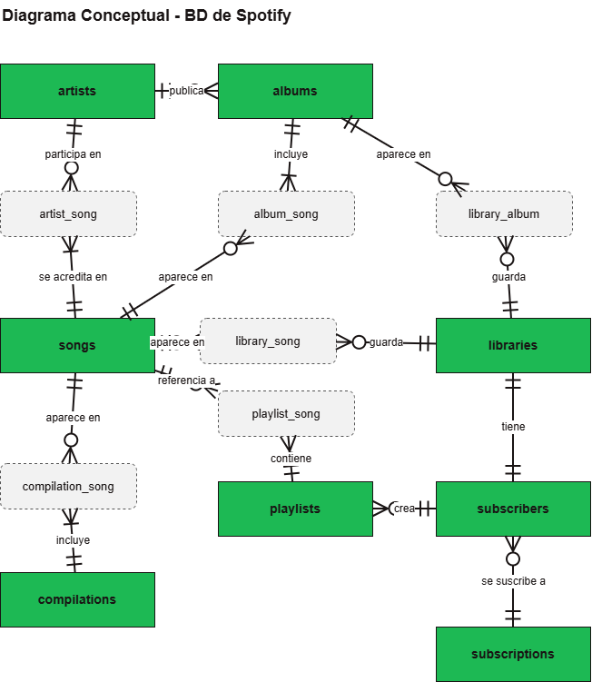
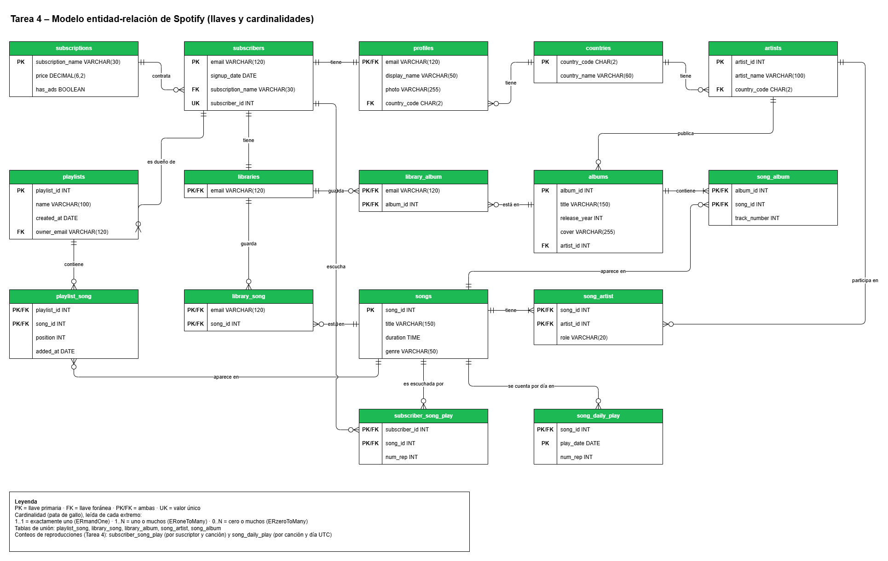

# Base de datos de Spotify

Tarea 3 del curso: implementación en PostgreSQL 18 de la base de datos transaccional de Spotify a partir del diagrama ER de la Tarea 2. La base se carga con los datos de Laura y se comprueba que sus reglas de negocio se cumplen.

Tarea 4: un simulador publica reproducciones en Kafka, un consumidor las guarda tal cual en un crudo de archivos y un proceso de cron cuenta cada 5 minutos las reproducciones válidas en dos tablas nuevas. Los mensajes no se guardan en PostgreSQL, solo los conteos.

## Contexto

Laura entregó cuatro exports del sistema anterior:

| Export | Contenido |
|---|---|
| Tabla A | Playlists: dueño, suscripción, precio, anuncios y sus canciones en orden |
| Tabla B | Créditos de canciones: duración, género y artistas con su país y su rol |
| Tabla C | Álbumes: año, portada, artista y pistas |
| Tabla D | Suscriptores: registro, suscripción, perfil y lo que guardan en su biblioteca |

En la Tarea 2 se normalizaron hasta 3FN. El resultado son 14 tablas: 9 entidades (`subscriptions`, `subscribers`, `profiles`, `libraries`, `playlists`, `songs`, `artists`, `albums` y `countries`) y 5 tablas de unión (`playlist_song`, `song_artist`, `song_album`, `library_song` y `library_album`).

En la Tarea 4 se agregan 2 tablas de conteos y una columna:

| Tabla | Llave | Qué guarda |
|---|---|---|
| `subscriber_song_play` | (`subscriber_id`, `song_id`) | cuántas veces escuchó cada suscriptor cada canción, desde siempre |
| `song_daily_play` | (`song_id`, `play_date`) | cuántas veces se escuchó cada canción cada día (UTC) |
| `subscribers.subscriber_id` | `UNIQUE` | identificador entero del suscriptor que usan los mensajes de Kafka |

## Diagramas

### Diagrama conceptual



### Diagrama ER

Tablas, columnas, tipos de dato, PK, FK y cardinalidades. Es el que implementan `db/01_schema.sql` y `db/03_play_counts.sql`. El PNG se exportó de draw.io con una copia del diagrama incluida, así que se puede abrir y editar directamente en draw.io.



## Estructura

```
app_simulator/
  producer.py          publica reproducciones en Kafka y escribe sent.log
db/
  01_schema.sql        tablas, llaves y restricciones
  02_seed.sql          datos de Laura y casos extra
  03_play_counts.sql   migración de la Tarea 4: subscriber_id y tablas de conteos
docs/
  diagrama_conceptual.png
  diagrama_er.png
ingestion/
  consumer.py          guarda cada mensaje en el crudo
  processor.py         cuenta las reproducciones nuevas del crudo
  crontab              corre processor.py cada 5 minutos
  verify.py            compara sent.log contra los conteos de la base
.env.example           plantilla de variables
.gitignore
.python-version
Dockerfile             imagen de Python con uv y cron para producer, consumer y processor
docker-compose.yml     postgres, kafka, producer, consumer y processor
pyproject.toml         dependencias de Python
uv.lock
tests.sql              consultas de Laura, intentos de romper reglas, transacciones y consultas de reproducciones
```

## Variables del .env

El archivo `.env` no se sube al repositorio. Se crea a partir de la plantilla:

```
cp .env.example .env
```

| Variable | Valor | Uso |
|---|---|---|
| `POSTGRES_USER` | `admin` | usuario que crea PostgreSQL al inicializarse |
| `POSTGRES_PASSWORD` | la que elijas | contraseña de ese usuario |
| `POSTGRES_DB` | `spotify` | base de datos donde se crean las tablas |
| `KAFKA_TOPIC` | `streams` | tópico donde se publican las reproducciones y prefijo de los archivos del crudo |
| `INTERVAL_SECONDS` | `1` | segundos entre una reproducción y la siguiente |
| `SKIP_RATE` | `0.2` | proporción de reproducciones con menos de 30 segundos (skips) |
| `DUPLICATE_RATE` | `0.1` | proporción de reproducciones que se vuelven a enviar |
| `MAX_DUPLICATE_DELAY_SECONDS` | `300` | retraso máximo de un duplicado; no puede pasar de 300 |
| `MAX_PLAY_AGE_DAYS` | `14` | `played_at` cae en los últimos N días |

Los valores de PostgreSQL solo se usan cuando el volumen está vacío. Si se cambian después, hay que borrar el volumen con `docker compose down -v`.

## Cómo iniciar todo

Desde la carpeta del repositorio, en la terminal de Ubuntu:

```
docker compose up -d --build
```

Se levantan 5 servicios: `postgres`, `kafka`, `producer`, `consumer` y `processor`. La primera vez PostgreSQL ejecuta `db/01_schema.sql`, `db/02_seed.sql` y `db/03_play_counts.sql`. Después de unos segundos se revisa que todo esté arriba y que no haya errores:

```
docker compose ps
docker compose logs postgres | grep ERROR
```

Si el segundo comando no muestra nada, la inicialización terminó bien. Para empezar desde cero:

```
docker compose down -v
docker compose up -d --build
```

Si se cambia un archivo `.py`, se vuelve a correr `docker compose up -d --build`.

### Aplicar la migración a una base que ya tiene datos

`03_play_counts.sql` solo se ejecuta sola cuando el volumen está vacío. En una base de la Tarea 3 que ya tiene datos se aplica a mano; usa `IF NOT EXISTS`, así que correrla dos veces no hace nada:

```
docker compose exec postgres psql -U admin -d spotify -f /docker-entrypoint-initdb.d/03_play_counts.sql
```

## Flujo de las reproducciones

1. **producer** lee los `subscriber_id` y `song_id` que existen y publica cada `INTERVAL_SECONDS` un mensaje en el tópico:

   ```json
   {"event_id": "…", "subscriber_id": 2, "song_id": 105, "played_at": "2026-11-03T18:22:10+00:00", "ms_played": 154000}
   ```

   Una parte son skips (`ms_played` < 30000) y otra se reenvía igual entre 0 y `MAX_DUPLICATE_DELAY_SECONDS` después. Cada original que Kafka confirma se escribe una vez en `/app/logs/sent.log`.
2. **consumer** escribe cada mensaje, tal cual llega, como una línea del crudo. El offset se guarda después de escribir la línea, así que si el consumer se cae no se pierde ningún mensaje; a lo mucho se vuelven a escribir los últimos que ya estaban en el crudo, y el processor los quita como duplicados.
3. **processor** corre con cron cada 5 minutos, lee solo las líneas nuevas del crudo, quita duplicados y skips y suma los conteos en las dos tablas.

### Cómo se organiza el crudo

El crudo vive en el volumen `crudo`, en `/app/data/raw/`, con un archivo por hora UTC:

```
/app/data/raw/streams_2026-11-09T20.log
/app/data/raw/streams_2026-11-09T21.log
```

La hora es la del timestamp con que el mensaje llegó a Kafka, no la de `played_at`, porque `played_at` puede ser de hace días y entonces se escribiría en archivos viejos. Así el consumer solo agrega al final del archivo de la hora actual, los archivos de horas pasadas ya no cambian y cada archivo queda chico. El crudo nunca se modifica: si hay un error en los conteos se pueden recalcular desde ahí.

### Cómo sabe el processor qué ya leyó

`/app/data/estado.json` guarda cuántas líneas de cada archivo ya se procesaron (`{"streams_2026-11-09T20.log": 3600}`). En cada corrida solo se leen las líneas completas que siguen; una línea que el consumer está escribiendo en ese momento se deja para la siguiente corrida. Los conteos se suman en una sola transacción y el estado se guarda después del `COMMIT`: si la corrida falla antes, no se suma nada y la siguiente vuelve a leer las mismas líneas.

### Cómo se quitan los duplicados

Un duplicado tiene el mismo `event_id` que el original y llega a lo mucho 300 segundos después, así que el original está en el mismo archivo o en el de la hora anterior. Para cada archivo con líneas nuevas el processor junta los `event_id` ya procesados de ese archivo y del de la hora anterior, y descarta las líneas nuevas cuyo `event_id` ya está ahí o ya apareció antes en la misma corrida. No hace falta guardar todos los `event_id` de la historia.

### Qué se descarta

| Motivo | Regla |
|---|---|
| duplicado | `event_id` ya visto (ver arriba) |
| skip | `ms_played` < 30000 |
| mal formado | la línea no es JSON, le falta un campo o `played_at` no tiene zona horaria |
| ids que no existen | el `subscriber_id` o el `song_id` no están en la base |

### Log del processor

Cada corrida escribe una línea con lo que leyó, lo que contó y cuánto descartó por cada motivo:

```
docker compose exec processor cat /app/logs/processor.log
```

Salida real de la misma corrida de prueba:

```
2026-11-10T05:35:02+0000 WARNING El crudo de streams todavia no existe en /app/data/raw
2026-11-10T05:40:02+0000 INFO Corrida: 310 mensajes leidos, 243 contados; descartados: 11 duplicados, 56 skips, 0 mal formados, 0 con ids que no existen
2026-11-10T05:45:01+0000 INFO Corrida: 330 mensajes leidos, 241 contados; descartados: 32 duplicados, 57 skips, 0 mal formados, 0 con ids que no existen
2026-11-10T05:50:02+0000 INFO Corrida: 316 mensajes leidos, 234 contados; descartados: 18 duplicados, 64 skips, 0 mal formados, 0 con ids que no existen
2026-11-10T05:55:02+0000 INFO Corrida sin mensajes nuevos
```

La primera corrida avisa que el crudo aún no existe porque el consumer todavía no había recibido mensajes; la última es después de detener el producer.

## Cómo verificar los conteos

`ingestion/verify.py` cuenta por canción las reproducciones válidas de `sent.log` (`ms_played` >= 30000, sin repetir `event_id`), las compara con la suma por canción de `song_daily_play` y de `subscriber_song_play`, y muestra `OK` si todo coincide o la lista de canciones con diferencias. Se ejecuta en el contenedor del processor:

```
docker compose exec processor /app/.venv/bin/python /app/ingestion/verify.py
```

Para que coincida, el processor tiene que haber leído todo lo que se envió. Lo más sencillo es detener el producer, esperar a la siguiente corrida de cron (minuto múltiplo de 5) y entonces ejecutar `verify.py`:

```
docker compose stop producer
```

Salida real partiendo de cero (`docker compose down -v`, `docker compose up -d --build`, 15 minutos corriendo, `docker compose stop producer` y la siguiente corrida de cron):

```
INFO Cancion 101: sent.log 81, song_daily_play 81, subscriber_song_play 81
INFO Cancion 102: sent.log 95, song_daily_play 95, subscriber_song_play 95
INFO Cancion 103: sent.log 82, song_daily_play 82, subscriber_song_play 82
INFO Cancion 104: sent.log 99, song_daily_play 99, subscriber_song_play 99
INFO Cancion 105: sent.log 83, song_daily_play 83, subscriber_song_play 83
INFO Cancion 106: sent.log 104, song_daily_play 104, subscriber_song_play 104
INFO Cancion 107: sent.log 77, song_daily_play 77, subscriber_song_play 77
INFO Cancion 108: sent.log 97, song_daily_play 97, subscriber_song_play 97
INFO OK: 718 reproducciones validas en 8 canciones coinciden con la base
```

Si algo no coincide, en lugar de `OK` muestra `ERROR Hay diferencias en las canciones: …` y termina con código 1.

## Cómo correr las pruebas

```
docker compose exec postgres psql -U admin -d spotify -f /tests.sql
```

Las pruebas dejan los datos igual que antes de correrlas, así que se pueden correr varias veces. Lo único que avanza es la secuencia de `subscriber_id`, porque PostgreSQL no regresa los valores que usó un `INSERT` que falló o que después se borró. Después de correrlas, `docker compose logs postgres | grep ERROR` también muestra los 17 errores de las pruebas, que son intencionales.

### a) Preguntas de Laura

| # | Pregunta | Resultado |
|---|---|---|
| 1 | ¿Qué canciones tiene la playlist 10, en orden, y quiénes son sus artistas? | 1 Ella Baila Sola (Eslabon Armado, Peso Pluma), 2 TQG (Karol G, Shakira), 3 Bzrp Music Sessions #53 (Bizarrap, Shakira) |
| 2 | ¿Cuántos suscriptores tiene cada suscripción? | Familiar 2, Gratuita 1, Premium 1, Estudiantes 0 |
| 3 | ¿Qué canciones no están en ningún álbum? | 108 Calor de Agosto |
| 4 | ¿Qué tiene guardado cada suscriptor en su biblioteca? | Canciones y álbumes en una sola lista; marta aparece sin nada guardado |
| 5 | ¿Cuál es la canción más escuchada? | Ya se puede responder: la que suma más `num_rep` en `song_daily_play`. Depende de las reproducciones simuladas; si hay empate salen todas |

### b) Intentos de romper las reglas

12 instrucciones que PostgreSQL rechaza con `ERROR`, al menos una por cada tipo de restricción:

| Restricción | Qué se intenta |
|---|---|
| `PRIMARY KEY` | repetir un `song_id`; repetir una canción en la misma playlist |
| `FOREIGN KEY` | playlist de un suscriptor que no existe; cambiar a una suscripción que no existe; borrar un artista con canciones |
| `NOT NULL` | suscriptor sin suscripción; álbum sin artista |
| `UNIQUE` | dos canciones en la misma posición de una playlist; dos canciones con la misma pista en un álbum |
| `CHECK` | precio negativo; rol distinto de `principal` o `feat.`; posición 0 |

### c) Registro y eliminación de un suscriptor

Cada operación es una transacción todo o nada:

1. **Registro exitoso:** se crea sofia@mail.com con su perfil y su biblioteca, y se confirma con `COMMIT`.
2. **Registro fallido:** pedro@mail.com tiene un perfil con país `XX`, que no existe. La transacción falla y termina en `ROLLBACK`; la consulta de antes y la de después muestran que no quedó nada.
3. **Eliminación fallida:** a ana@mail.com se le borran playlists y biblioteca, pero se intenta borrar el suscriptor antes que su perfil. La llave foránea lo impide y todo regresa con `ROLLBACK`; los conteos de antes y después son iguales.
4. **Eliminación exitosa:** sofia crea una playlist, guarda una canción y un álbum, y tiene reproducciones de 2 canciones en `subscriber_song_play`. Después se borran en orden sus reproducciones, sus canciones de playlist, sus playlists, lo guardado, su biblioteca, su perfil y el suscriptor. El catálogo sigue con 8 canciones, 6 álbumes y 11 artistas.

Borrar a un suscriptor no cambia el top semanal: `song_daily_play` no guarda quién escuchó, así que sus reproducciones se quedan en los conteos por día.

### d) Consultas de reproducciones

| Consulta | Tabla | Regla |
|---|---|---|
| Top 100 semanal | `song_daily_play` | la última semana completa, de lunes a domingo en UTC; la semana en curso no cuenta (si hoy es martes 3 de noviembre, va del lunes 26 de octubre al domingo 1 de noviembre) |
| Las 20 canciones más escuchadas de un suscriptor | `subscriber_song_play` | desde siempre; en las pruebas se usa ana@mail.com |
| La canción más escuchada (pregunta 5) | `song_daily_play` | suma de todos los días |

## Supuestos

Además de los supuestos de la Tarea 2:

- Los artistas de Laura tienen identificadores `A1` a `A10`. Como el ER define `artist_id` como `INT`, se guarda solo el número (`A1` es 1, `A10` es 10).
- Las duraciones como `2:45` son minutos y segundos, y se guardan como `TIME` en formato `00:02:45`.
- La playlist vacía (13, Viaje) y la canción sin álbum (108, Calor de Agosto) ya venían en los datos de Laura, así que no se agregaron otras. Se agregaron la suscripción `Estudiantes` (69 MXN, sin anuncios), que no tiene suscriptores, y el artista 11, Natalia Lafourcade, sin canciones ni álbumes.
- La foto del perfil y la portada del álbum pueden quedar vacías (Marta no tiene foto).
- El rol de un artista en una canción solo puede ser `principal` o `feat.`.
- La posición en una playlist y el número de pista en un álbum empiezan en 1 y no se repiten dentro de la misma playlist o álbum.
- El año de un álbum va de 1900 a 2100 y la duración de una canción es mayor a cero.
- El nombre de un país no se repite.

Decisiones de la Tarea 4:

- **`subscriber_id` agregado por migración.** Los mensajes identifican al suscriptor con un entero, pero la llave de `subscribers` es el correo. En lugar de editar `01_schema.sql`, `03_play_counts.sql` agrega `subscriber_id` como `GENERATED ALWAYS AS IDENTITY UNIQUE` (ana 1, luis 2, marta 3, diego 4 en el orden del seed) y `subscriber_song_play` apunta a esa columna. Una migración aplicada no se edita: un cambio de esquema nuevo va en `04_...`.
- **`sent.log` en el volumen `logs`.** El producer escribe ahí cada original que Kafka confirmó, sin duplicados. Ese volumen lo comparten producer, consumer y processor, así que `verify.py` lo lee desde el contenedor del processor sin tocar Kafka ni el crudo.
- **`estado.json` en el volumen `crudo`.** Vive junto al crudo que describe, de modo que `docker compose down -v` borra los dos juntos y nunca quedan desalineados.
- **Ids que no existen se descartan.** Si un mensaje trae un `subscriber_id` o un `song_id` que no está en la base, no se cuenta (la llave foránea lo rechazaría y tumbaría el lote completo); queda en el crudo y en el log del processor.
- **Fechas en UTC.** `played_at` trae zona horaria y se convierte a UTC antes de tomar la fecha para `song_daily_play`; los archivos del crudo y la semana del top semanal también usan UTC.
- **Borrar un suscriptor.** Como `song_daily_play` no guarda al suscriptor, después de borrar a uno con reproducciones la suma por canción de `subscriber_song_play` queda menor que la de `song_daily_play`. `verify.py` asume que no se ha borrado ningún suscriptor con reproducciones.

## Cardinalidades y restricciones

| Cardinalidad del ER | Restricción |
|---|---|
| Mínimo 1 del lado "uno" (toda fila hija tiene padre) | FK `NOT NULL`, por ejemplo `subscribers.subscription_name`, `playlists.owner_email`, `albums.artist_id` |
| Relación 1:1 de suscriptor con perfil y con biblioteca | la PK de `profiles` y `libraries` es a la vez FK a `subscribers.email` |
| Relaciones N:M | tabla de unión con PK compuesta y una FK a cada lado |
| Conteos de reproducciones | PK compuesta y `CHECK (num_rep > 0)`: si una combinación no tiene reproducciones no tiene fila |

Ninguna llave foránea usa `ON DELETE CASCADE`: para borrar un suscriptor hay que borrar sus dependencias de forma explícita, y no se puede borrar del catálogo algo que está en uso.

Algunos mínimos de 1 van en el lado contrario a la llave foránea y no se pueden forzar solo con restricciones:

- Todo suscriptor tiene un perfil y una biblioteca. Se garantiza con la transacción de registro, que inserta los tres o ninguno.
- Toda canción tiene al menos un artista y todo álbum tiene al menos una canción. Se cumple en los datos, pero la base no lo impide.

## Cambios respecto al ER

El esquema de la Tarea 3 sigue el diagrama ER de la Tarea 2 sin cambios en tablas, columnas, tipos ni llaves; solo se agregaron restricciones `CHECK` y `UNIQUE` que no se dibujan en el diagrama (las de la sección de supuestos). En la Tarea 4 el diagrama se actualizó con `subscribers.subscriber_id`, `subscriber_song_play` y `song_daily_play`.
